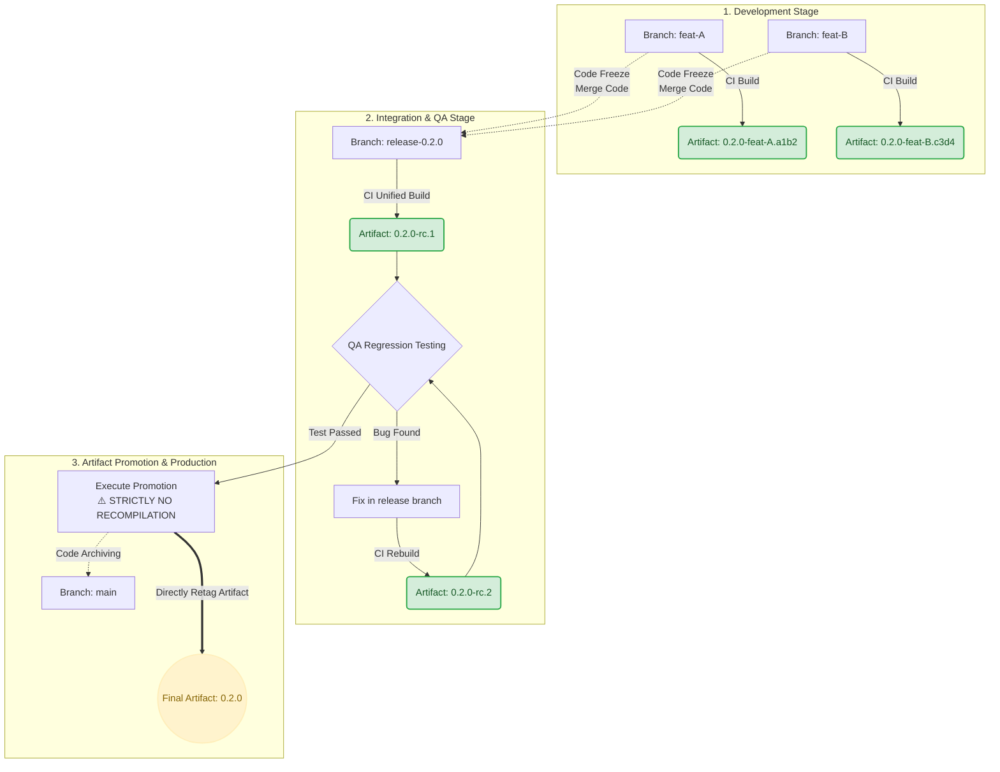

```mermaid
**Artifact Versioning and Release Management Policy**

**I. Core Principles**

1. **Unified Release Planning:** All target version numbers (following Semantic Versioning: MAJOR.MINOR.PATCH) shall be centrally planned and allocated via the *Release Registry Matrix*. Unauthorized assignment or modification of major/minor version numbers by individual developers is strictly prohibited.
2. **Artifact Immutability:** Every generated artifact must possess a globally unique version identifier. Overwriting, replacing, or forcibly pushing to an existing artifact tag in the artifact repository is strictly forbidden.
3. **Artifact Promotion Model:** The final production artifact shall **never be recompiled**. Production releases must be executed by directly promoting (re-tagging) the exact Release Candidate (RC) artifact that successfully passed QA validation.

**II. Release Stages & Naming Conventions**

| Release Phase | Associated Branch | Artifact Version Format | Example | Description |
| --- | --- | --- | --- | --- |
| **1. Feature Development (Dev)** | `feat-xxx` | `<TARGET_VERSION>-<BRANCH_NAME>.<SHORT_HASH>` | `0.2.0-feat-login.a1b2c3d` | Utilized for local and isolated environment testing. The Git commit hash guarantees strict version uniqueness. |
| **2. Release Candidate (RC)** | `release-<TARGET_VERSION>` | `<TARGET_VERSION>-rc.<BUILD_NUMBER>` | `0.2.0-rc.1` | Triggered post-code freeze. Feature branches are merged into the release branch to generate an RC artifact for comprehensive QA regression testing. |
| **3. Production Release (Prod)** | `main` (with Tag) | `<TARGET_VERSION>` | `0.2.0` | Upon RC approval, the CI/CD pipeline seamlessly promotes the verified `rc.X` artifact to the formal production release. Code is subsequently merged into the main trunk. |

**III. Standard Operating Procedures (SOP)**

1. **Pre-Release (Scheduling & Allocation):** Technical Leads or Product Managers must register the upcoming release cycle (e.g., `0.2.0`) in the *Release Registry Matrix* prior to development. All concurrent feature branches shall base their CI configurations on this target version.
2. **Active Release (Integration & Code Freeze):** Upon reaching the established QA cut-off date, all completed feature branches must be merged into the designated `release-X.X.X` branch. A strict code freeze is enacted immediately; thereafter, only targeted bug fixes for the current release are permitted to be merged.
3. **Post-Release (Archiving & Transition):** Following a successful production deployment, the version status in the registry must be updated to "Released." The release branch is merged into `main`, and development for the subsequent iteration shall commence by branching off the updated `main` branch.
```

